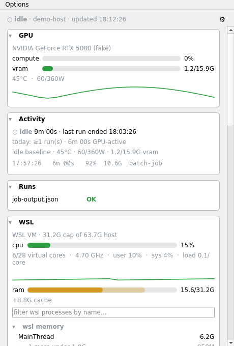

# Vision Resource Monitor

A system-tray (or plain window) monitor for GPU, host, memory, session and port
activity, built for a Windows desktop with a WSL environment behind it. It is
written with PySide6.

## How it works

Collection and judgment happen on one side; painting happens on the other.

```
  producer (WSL / any host)                  this app (PySide6)
  collects, classifies, decides   -------->  reads, paints, notifies
  writes one JSON snapshot per tick          tray icon + window + toasts
  (atomic replace, on a path both sides see)
```

* The **producer** reads `/proc`, the container runtime, GPU counters and so
  on, makes every liveness and "is it running" judgment where it is valid, and
  writes one UI-ready snapshot per tick, replacing the file atomically.
* This app is a **pure renderer**: it never inspects processes itself. It polls
  the file, judges freshness by the file's local modification time, and paints.
* The feed format is **`monitor-snapshot:v1`**. See the
  [schema reference](docs/snapshot-schema.md) and the small reference producer.
* **Missing data is shown as missing.** A tier the producer could not collect
  renders a stated cause (for example "unavailable" with a reason) instead of
  disappearing, a stale feed says stale, and an absent feed says no data. The
  app does not claim a cause it cannot observe.

## Run it live

The reference producer requires Linux `/proc`; `nvidia-smi` is optional, and
GPU data stays absent when it is unavailable. Other tiers it cannot collect
remain absent and appear as no data in the app.

In one terminal, write snapshots to a path both the producer and app can read:

```bash
python3 -m vision_resource_monitor.reference_producer /path/to/status.json
```

In another terminal, open that feed:

```bash
vision-resource-monitor --snapshot /path/to/status.json
```

## Install from source

Python 3.9 or newer.

```bash
uv venv && . .venv/bin/activate          # or: python3 -m venv .venv
uv pip install -e ".[gui]"               # or: pip install -e ".[gui]"
```

* The core (snapshot parsing, reader, state, fake producer) has **no required
  dependencies**; `pip install -e .` is enough for it.
* The `gui` extra adds PySide6 and `procmon-parser`.
* The `dev` extra adds pytest.

## Quick start: the demo

No producer needed. The demo starts the bundled fake producer writing to a
temporary snapshot, opens the window on it, and removes everything on exit:

```bash
python3 -m vision_resource_monitor --demo
```

`--demo` implies `--window`, ignores `--snapshot`, uses its own instance lock
(so it does not clash with a running tray), and turns the live actions off (see
below). The data is synthetic.



Run against a live feed:

```bash
vision-resource-monitor --snapshot /path/to/status.json
```

Without `--snapshot`, the path is the saved setting, then `$VRM_SNAPSHOT_PATH`,
then public builds use `status.json` under `vision-resource-monitor` in the
platform state directory. Development builds retain their legacy data
directory for producer compatibility. On Windows the state directory is
`%LOCALAPPDATA%`; elsewhere it is `$XDG_STATE_HOME` or `~/.local/state`.

## Command line

| Flag | Meaning |
|---|---|
| `--demo` | Run against the bundled fake producer, live actions off; implies `--window` |
| `--snapshot PATH` | Snapshot file to read |
| `--interval SECONDS` | Poll interval (must be greater than zero) |
| `--stale-after SECONDS` | Seconds without a new snapshot before showing "stale" |
| `--log-file PATH` | Activity log opened by "Open activity log" |
| `--log-level LEVEL` | `DEBUG`, `INFO`, `WARNING` or `ERROR` (also `$VRM_LOG_LEVEL`) |
| `--window` | Show a window instead of a tray icon; closing it quits |
| `--allow-multiple` | Skip the single-instance guard |
| `--theme dark\|light`, `--dark`, `--light` | Colour theme |
| `--host` / `--no-host` | Show / hide the Host (CPU, RAM) panel |
| `--mem` / `--no-mem` | Show / hide the Memory panel |
| `--mute` / `--no-mute` | Mute / show tray notification pop-ups (toasts are still logged) |
| `--version` | Print the version |

Without `--window`, the app needs a system tray and exits with a message if the
desktop has none (WSLg, for example); use `--window` there.

## Settings

A flag wins, then the saved setting, then the built-in default. Settings are
saved with Qt `QSettings` (the registry on Windows). Open **Settings...** from
the tray menu or the window's Options menu to change log level, theme, poll
interval, stale-after, the snapshot and log paths, notifications, panel order
and visibility, and the producer-side options. Producer-side options are
written to a `monitor-config.json` next to the snapshot; a producer that reads
it can apply them.

## Live actions

In a development checkout, a few rows can act on the machine: releasing a
session's node processes, opening a Windows process in Process Monitor with a
filter, handing a memory contributor to a command-line assistant, and an
in-app rebuild/update prompt for the Windows executable. The public build and
`--demo` switch all of these off: their buttons are hidden or disabled with the
reason stated, and the update prompt is replaced by a plain "Version X" line.

## Logging

A rotating activity log is written to `vision-resource-monitor/logs/vrm.log`
under the per-user state folder (`%LOCALAPPDATA%` on Windows; otherwise
`$XDG_STATE_HOME` or `~/.local/state`) and mirrored to the console when run
from a terminal. It records the snapshot path, each read (fresh, stale or
missing, with age), parse errors, status transitions and toasts. At `DEBUG` it
also records why a panel is blank.

## Tests

```bash
uv pip install -e ".[gui,dev]"
python3 -m pytest -q                                   # headless
python3 -m pytest -m winps                             # real Windows PowerShell e2e tests
```

## License

MIT. See `LICENSE`.
